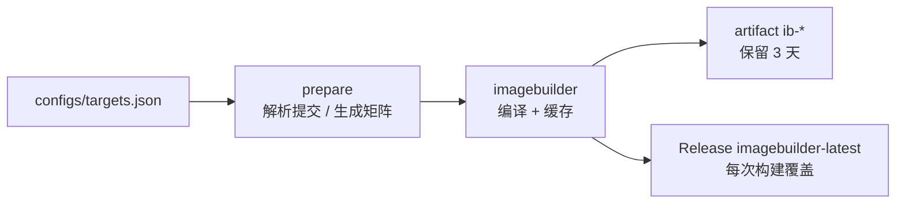

# LEDE ImageBuilder Action

用 [coolsnowwolf/lede](https://github.com/coolsnowwolf/lede) 源码构建 **ImageBuilder**，并以 artifact / GitHub Release 的形式提供下载。工作流**只构建 ImageBuilder，不编译固件**；固件由你拿到 IB 后自行生成。

lede 不发布官方 ImageBuilder（[releases](https://github.com/coolsnowwolf/lede/releases) 里只有少量整机固件），所以需要先编译；这一阶段按上游提交 + 配置做缓存，只有 lede 更新或 `configs/targets.json` 变化时才重新编译。



## 文件结构

| 路径 | 作用 |
| --- | --- |
| `.github/workflows/imagebuilder.yml` | 编译 ImageBuilder → 更新固定 Release |
| `.github/workflows/firmware.yml` | 从 Release 下载 ImageBuilder → 生成固件 |
| `configs/targets.json` | ImageBuilder：构建哪些 target/subtarget、设备 profile、预编译哪些包 |
| `configs/feeds.conf` | 第三方源码 feed（追加到 lede 的 feeds.conf.default） |
| `configs/firmware.json` | 固件：用哪个 IB、哪个 profile、装哪些包 |

## 快速开始

1. 把本目录推送到自己的 GitHub 仓库。
2. 按需修改 `configs/targets.json`（见下节）。
3. 打开仓库 **Actions → lede-imagebuilder → Run workflow**（或 push 配置 / 打 tag）。
4. 获取 ImageBuilder：
   - Actions 运行页底部 artifact `ib-<target>-<subtarget>`（保留 3 天）；
   - 每次成功构建还会更新 Release `imagebuilder-latest`，固定下载地址永久可用。

触发方式：

| 触发 | 条件 |
| --- | --- |
| `workflow_dispatch` | 手动，可选 `lede_repo`、`lede_ref` |
| `schedule` | 每周一 02:00 (UTC+8) 跟随上游重建 |
| `push`（分支） | 修改 `configs/targets.json` 或本工作流时 |
| `push`（tag） | 同分支推送一样构建；Release 仍是 `imagebuilder-latest`（tag 推送不评估 `paths`） |

## 配置 targets.json

```json
{
  "targets": [
    {
      "name": "x86-64-generic",
      "target": "x86",
      "subtarget": "64",
      "profile": "generic",
      "packages": ["luci-app-ttyd", "openssh-sftp-server"]
    }
  ]
}
```

| 字段 | 必填 | 说明 |
| --- | --- | --- |
| `name` | 是 | 任务/产物名，唯一，避免空格和 `/` |
| `target` | 是 | 如 `x86`、`ramips`、`rockchip`、`mediatek` |
| `subtarget` | 是 | 如 `64`、`mt7621`、`filogic`；只有一个子目标的 target 也写其目录名（如 `generic`） |
| `profile` | 是 | ImageBuilder 设备名（小写），**必须属于该 target/subtarget** |
| `packages` | 否 | 额外预编译进 IB 本地 ipk 仓库的软件包 |


工作流会：

- 按 `target`+`subtarget` 去重，每个组合产出一个 ImageBuilder；
- 把该 target 下所有 `profile` 用多设备模式选中，确保这些设备相关的包被编译；
- 把这些配置的 `packages` **并集**写进构建配置，随 IB 一起打包进本地仓库，之后 `make image` 才能离线安装；
- 不会生成任何固件镜像。

### 如何确定 target / subtarget / profile

- 浏览 `target/linux/<target>/<subtarget>/target.mk` 与 `target/linux/<target>/image/*.mk`；`define Device/<name>` 里的 `<name>` 就是 `profile`。
- 或下载工作流产出的 ImageBuilder，解压后执行 `make info`，列出全部 profile 与默认包。

例如 ramips/mt7621 上小米 4A 千兆：

```json
{
  "name": "xiaomi-4a-gigabit",
  "target": "ramips",
  "subtarget": "mt7621",
  "profile": "xiaomi_mi-router-4a-gigabit",
  "packages": ["luci-app-ttyd"]
}
```

> `profile` 写错会在 IB 构建阶段被断言拦下（`profile 不存在或无法选中`），不会产出错误目标。

## 添加第三方软件（源码 feed）

和 `build-actions_my` 的做法一致：往 `feeds.conf.default` 里追加 `src-git`，再用包名选中。区别是 ImageBuilder 不能编译，所以**编译发生在 ImageBuilder 阶段**，一共三步：

1. **加源**：在 `configs/feeds.conf` 里写有效行（注释/空行会被忽略）：

```
src-git openclash https://github.com/vernesong/OpenClash.git;master
src-git danshui   https://github.com/281677160/openwrt-package.git;master
```

2. **让 IB 编译它**：在 `configs/targets.json` 的 `packages` 里加上包名：

```json
"packages": ["luci-app-ttyd", "openssh-sftp-server", "luci-app-openclash"]
```

3. **装进固件**：在 `configs/firmware.json` 的 `packages` 里再列一次。

工作流行为：

- `imagebuilder.yml` 在 `feeds update -a` 前把 `configs/feeds.conf` 的有效行追加到 `feeds.conf.default`，然后 `feeds update -a && feeds install -a`；
- `packages` 里的包会被 `CONFIG_PACKAGE_<pkg>=y` 选中并编译进 IB 的本地 ipk 仓库；
- `configs/feeds.conf` 的**有效内容**参与缓存键（空/全注释时不影响现有缓存），修改它会让 ImageBuilder 重新编译；
- 第三方 feed 必须兼容 lede 的版本和内核（kmod 尤其敏感），编译失败会直接体现在 IB 构建日志里。

> 单个包、又没有可用的 feed 时，也可以按同样的思路把源码目录放进 `package/` 再选中；当前工作流只支持 feed 这一种方式，需要时再加。

## ImageBuilder Release（固定下载地址）

每次 `imagebuilder` 成功都会更新**同一个** Release：`imagebuilder-latest`。

固定下载地址（target/subtarget 换成你的配置）：

```
https://github.com/xujw-org/lede-build/releases/download/imagebuilder-latest/imagebuilder-x86-64.tar.xz
https://github.com/xujw-org/lede-build/releases/download/imagebuilder-latest/SHA256SUMS
```

- 首次构建创建 tag `imagebuilder-latest` 并上传 `imagebuilder-<target>-<subtarget>.tar.xz` + `SHA256SUMS`；
- 之后每次构建执行 `gh release upload --clobber`，只覆盖同名资源，**下载地址保持不变**；
- 手动 dispatch、定时任务、默认分支 push、tag push，只要 IB 构建成功都会更新它，不再生成版本化 Release；
- 其他分支的 push 即使构建成功也不会覆盖 Release（避免 feature 分支改写公共下载地址）；
- release job 有独立并发组 `ib-release-latest`，多次构建不会并发写同一个 Release；
- tag 固定指向首次创建时的提交，它只是“下载桶”，最新内容以资源文件的构建时间和 `SHA256SUMS` 为准；
- Release 资源不计入 Actions artifacts 存储：单文件 < 2 GiB、每个 Release 最多 1000 个资源、无总大小与带宽限制；但不会自动过期。

要改固定名称，改工作流 `release` job 里的 `TAG: imagebuilder-latest`。

## 缓存与强制重建

ImageBuilder 缓存键：

```
ib-<CACHE_VERSION>-<lede 提交 SHA>-<target>-<subtarget>-<targets.json 哈希>
```

- lede 有新提交、或 `targets.json` 改动 → 自动重建；
- 想在不改配置的情况下强制重建：把工作流顶部的 `CACHE_VERSION`（默认 `v1`）改成 `v2`；
- 缓存中缺少/损坏的 tar 会被检测出来并重新编译。

## 构建细节

ImageBuilder 阶段的 `.config` 由工作流生成：

```
CONFIG_TARGET_<target>=y
CONFIG_TARGET_<target>_<subtarget>=y
CONFIG_TARGET_MULTI_PROFILE=y            # 同一 target 下选中多个设备
CONFIG_TARGET_PER_DEVICE_ROOTFS=y
CONFIG_TARGET_DEVICE_<target>_<subtarget>_DEVICE_<profile>=y
CONFIG_IB=y
CONFIG_IB_STANDALONE=y                   # 所有已编译 ipk 打包进本地仓库
CONFIG_PACKAGE_<pkg>=y                   # packages 并集
```

之后执行 `make -j$(nproc)`（失败时回退 `-j1 V=s` 看真实错误），产物为 `bin/targets/**/*imagebuilder*.tar.xz`。

## 用 GitHub Actions 构建固件

`.github/workflows/firmware.yml` 直接复用 Release 里的 ImageBuilder，不重新编译：

```
Actions → lede-firmware → Run workflow（可指定 ib_tag，默认 imagebuilder-latest）
```

流程：

1. `gh release download` 拉取 `imagebuilder-<ib>.tar.xz` 和 `SHA256SUMS`，用 `sha256sum -c` 校验；
2. 解压 IB；
3. `make info` 读取默认包，与 IB 包索引比对（`Package:` 与 `Provides:` 都算可用），**自动剔除不存在的默认包**（见下）；
4. `make image PROFILE=... PACKAGES=...` 生成固件；
5. 上传 artifact `firmware-<name>`（保留 30 天），并更新 Release `firmware-latest`。

配置 `configs/firmware.json`：

```json
{
  "images": [
    {
      "name": "x86-64-generic",
      "ib": "x86-64",
      "profile": "generic",
      "packages": ["luci-app-ttyd", "openssh-sftp-server"],
      "rootfs_partsize": "1024"
    }
  ]
}
```

| 字段 | 必填 | 说明 |
| --- | --- | --- |
| `name` | 是 | 任务/产物名，唯一 |
| `ib` | 是 | 与 Release 资产 `imagebuilder-<ib>.tar.xz` 对应，如 `x86-64` |
| `profile` | 是 | 该 IB 支持的 profile，如 `generic` |
| `packages` | 否 | 额外安装的包；`-pkg` 表示从默认集合移除 |
| `files` | 否 | 覆盖文件目录（相对仓库根目录） |
| `rootfs_partsize` | 否 | rootfs 分区 MB 数 |
| `disabled_services` | 否 | 禁用的 init 服务数组 |

### 关于“自动剔除默认包”

上游 `include/target.mk` / `target/linux/x86/Makefile` 的 `DEFAULT_PACKAGES` 里有一些已经删除或无法编译的包（当前是 `luci-app-accesscontrol`、`luci-app-turboacc`、`kmod-usb-audio`、`kmod-usb-net-rtl8152-vendor`、`kmod-sound-*`、`kmod-i40evf` 等）。它们不在 IB 的本地仓库里，直接 `make image` 会让 `opkg install` 失败。

工作流会把这些包从镜像列表里过滤掉，并在日志里输出一条 `::notice::本地仓库缺少 N 个默认包，已从镜像移除: ...` 汇总。判断依据是 IB 生成一次的包索引（`Package:` 与 `Provides:` 都算可用），所以 `libgcc`、`libustream-openssl`、`libip6tc` 这类由 `libgcc1` 等包提供的虚拟名不会被误删；`libc`、`kernel` 由 image 构建单独安装，始终视为可用。预检生成的索引会在判断后删除，`make image` 会重新生成并签名，不会绕过签名检查。想要某个包，必须在构建 IB 时让它真正编译出来（加入 `configs/targets.json` 的 `packages`，且该包在 feeds 里存在）。

## 固件 Release（固定下载地址）

每次 `build` 成功后更新同一个 Release `firmware-latest`：

```
https://github.com/xujw-org/lede-build/releases/download/firmware-latest/openwrt-x86-64-generic-squashfs-combined-efi.img.gz
https://github.com/xujw-org/lede-build/releases/download/firmware-latest/SHA256SUMS
```

- 下载全部 `firmware-*` artifact 后拉平；同名文件（不同配置的镜像/manifest）自动加 `<配置名>_` 前缀，`sha256sums` 跳过并统一生成 `SHA256SUMS`；
- Release 已存在时 `gh release upload --clobber`，只覆盖同名资源，下载地址不变；
- 只有默认分支或 tag 的构建会更新它，feature 分支不会覆盖公共地址；
- release job 有独立并发组 `fw-release-latest`；
- artifact 仍保留 30 天，Release 资源永久保留（需要手动清理）。

要改固定名称，改 `firmware.yml` 里 `release` job 的 `TAG: firmware-latest`。

## 用 ImageBuilder 在本地生成固件

```sh
tar -xJf imagebuilder-x86-64.tar.xz -C ib
cd ib/openwrt-imagebuilder-*/
make info                                   # 查看可用 profile 与默认包
make image \
  PROFILE=generic \
  PACKAGES="luci-app-ttyd openssh-sftp-server" \
  BIN_DIR="$PWD/out" \
  FILES="$OLDPWD/files"
```

`PACKAGES` 只能使用 IB 本地仓库里已有的 ipk —— 也就是构建 IB 时 `configs/targets.json` 里列出的那些包及其依赖。

## 注意事项

- `imagebuilder.yml` 只构建 ImageBuilder；固件由 `firmware.yml`（或本地 `make image`）生成。
- 首次构建（工具链、feeds、内核包）在 4 核 runner 上通常 40–90 分钟；命中缓存后只需重新打包 IB。
- 磁盘：编译阶段需要 25 GB 以上，工作流已调用 `free-disk-space` 并清理预装 SDK。
- ImageBuilder 与官方 OpenWrt 的包集合/内核不通用，不要混用 `downloads.openwrt.org` 的 opkg 源。
