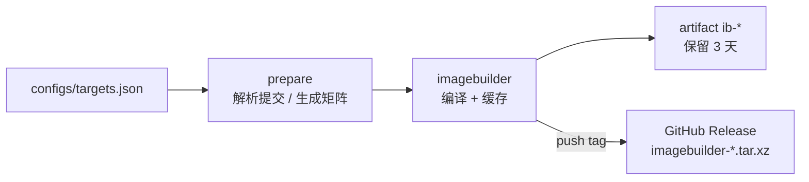

# LEDE ImageBuilder Action

用 [coolsnowwolf/lede](https://github.com/coolsnowwolf/lede) 源码构建 **ImageBuilder**，并以 artifact / GitHub Release 的形式提供下载。工作流**只构建 ImageBuilder，不编译固件**；固件由你拿到 IB 后自行生成。

lede 不发布官方 ImageBuilder（[releases](https://github.com/coolsnowwolf/lede/releases) 里只有少量整机固件），所以需要先编译；这一阶段按上游提交 + 配置做缓存，只有 lede 更新或 `configs/targets.json` 变化时才重新编译。



## 文件结构

| 路径 | 作用 |
| --- | --- |
| `.github/workflows/imagebuilder.yml` | 全部工作流：解析 → 编译 ImageBuilder → 按需发布 Release |
| `configs/targets.json` | 要构建哪些 target/subtarget、设备 profile、预编译哪些包 |

## 快速开始

1. 把本目录推送到自己的 GitHub 仓库。
2. 按需修改 `configs/targets.json`（见下节）。
3. 打开仓库 **Actions → lede-imagebuilder → Run workflow**（或 push 配置 / 打 tag）。
4. 获取 ImageBuilder：
   - Actions 运行页底部 artifact `ib-<target>-<subtarget>`（保留 3 天）；
   - **push tag** 会在 Releases 里生成永久下载：`imagebuilder-<target>-<subtarget>.tar.xz` + `SHA256SUMS`。

触发方式：

| 触发 | 条件 |
| --- | --- |
| `workflow_dispatch` | 手动，可选 `lede_repo`、`lede_ref`；不发布 Release |
| `schedule` | 每周一 02:00 (UTC+8) 跟随上游重建 |
| `push`（分支） | 修改 `configs/targets.json` 或本工作流时 |
| `push`（tag） | push 任意 tag：构建并把 ImageBuilder 发布到 Release（tag 推送不评估 `paths`） |

## 配置 targets.json

```json
{
  "targets": [
    {
      "name": "x86-64-generic",
      "target": "x86",
      "subtarget": "64",
      "profile": "generic",
      "packages": ["luci-app-ttyd", "openssh-sftp-server"]
    }
  ]
}
```

| 字段 | 必填 | 说明 |
| --- | --- | --- |
| `name` | 是 | 任务/产物名，唯一，避免空格和 `/` |
| `target` | 是 | 如 `x86`、`ramips`、`rockchip`、`mediatek` |
| `subtarget` | 是 | 如 `64`、`mt7621`、`filogic`；只有一个子目标的 target 也写其目录名（如 `generic`） |
| `profile` | 是 | ImageBuilder 设备名（小写），**必须属于该 target/subtarget** |
| `packages` | 否 | 额外预编译进 IB 本地 ipk 仓库的软件包 |

工作流会：

- 按 `target`+`subtarget` 去重，每个组合产出一个 ImageBuilder；
- 把该 target 下所有 `profile` 用多设备模式选中，确保这些设备相关的包被编译；
- 把这些配置的 `packages` **并集**写进构建配置，随 IB 一起打包进本地仓库，之后 `make image` 才能离线安装；
- 不会生成任何固件镜像。

### 如何确定 target / subtarget / profile

- 浏览 `target/linux/<target>/<subtarget>/target.mk` 与 `target/linux/<target>/image/*.mk`；`define Device/<name>` 里的 `<name>` 就是 `profile`。
- 或下载工作流产出的 ImageBuilder，解压后执行 `make info`，列出全部 profile 与默认包。

例如 ramips/mt7621 上小米 4A 千兆：

```json
{
  "name": "xiaomi-4a-gigabit",
  "target": "ramips",
  "subtarget": "mt7621",
  "profile": "xiaomi_mi-router-4a-gigabit",
  "packages": ["luci-app-ttyd"]
}
```

> `profile` 写错会在 IB 构建阶段被断言拦下（`profile 不存在或无法选中`），不会产出错误目标。

## 发布 ImageBuilder Release（打 tag）

```sh
git tag v2026.11.05
git push origin v2026.11.05
```

Release 资源：

```
imagebuilder-x86-64.tar.xz
imagebuilder-<target>-<subtarget>.tar.xz
SHA256SUMS
```

- 触发规则是 `push.tags: ["**"]`；GitHub 对 tag 推送**不评估** `paths` 过滤。
- `release` job 只依赖 `imagebuilder`，IB 编译成功即发布，不存在固件阶段。
- 每个 `ib-*` artifact 会被重命名为 `imagebuilder-<target>-<subtarget>.tar.xz`，并生成 `SHA256SUMS`。
- Release 已存在时执行 `gh release upload --clobber`，只覆盖同名资源，不删除旧资源。
- Release 资源不计入 Actions artifacts 存储：单文件 < 2 GiB、每个 Release 最多 1000 个资源、无总大小与带宽限制；但不会自动过期，需要手动清理旧 tag/Release。

> 想要“每次构建都更新同一个下载地址”而不是打 tag，可把 `TAG` 改成固定的 `imagebuilder-latest`，在每次成功构建后 `gh release upload --clobber`。

## 缓存与强制重建

ImageBuilder 缓存键：

```
ib-<CACHE_VERSION>-<lede 提交 SHA>-<target>-<subtarget>-<targets.json 哈希>
```

- lede 有新提交、或 `targets.json` 改动 → 自动重建；
- 想在不改配置的情况下强制重建：把工作流顶部的 `CACHE_VERSION`（默认 `v1`）改成 `v2`；
- 缓存中缺少/损坏的 tar 会被检测出来并重新编译。

## 构建细节

ImageBuilder 阶段的 `.config` 由工作流生成：

```
CONFIG_TARGET_<target>=y
CONFIG_TARGET_<target>_<subtarget>=y
CONFIG_TARGET_MULTI_PROFILE=y            # 同一 target 下选中多个设备
CONFIG_TARGET_PER_DEVICE_ROOTFS=y
CONFIG_TARGET_DEVICE_<target>_<subtarget>_DEVICE_<profile>=y
CONFIG_IB=y
CONFIG_IB_STANDALONE=y                   # 所有已编译 ipk 打包进本地仓库
CONFIG_PACKAGE_<pkg>=y                   # packages 并集
```

之后执行 `make -j$(nproc)`（失败时回退 `-j1 V=s` 看真实错误），产物为 `bin/targets/**/*imagebuilder*.tar.xz`。

## 用 ImageBuilder 在本地生成固件

```sh
tar -xJf imagebuilder-x86-64.tar.xz -C ib
cd ib/openwrt-imagebuilder-*/
make info                                   # 查看可用 profile 与默认包
make image \
  PROFILE=generic \
  PACKAGES="luci-app-ttyd openssh-sftp-server" \
  BIN_DIR="$PWD/out" \
  FILES="$OLDPWD/files"
```

`PACKAGES` 只能使用 IB 本地仓库里已有的 ipk —— 也就是构建 IB 时 `configs/targets.json` 里列出的那些包及其依赖。

## 注意事项

- 工作流**不生成固件**；固件、分区大小、覆盖文件等都在本地 `make image` 阶段决定。
- 首次构建（工具链、feeds、内核包）在 4 核 runner 上通常 40–90 分钟；命中缓存后只需重新打包 IB。
- 磁盘：编译阶段需要 25 GB 以上，工作流已调用 `free-disk-space` 并清理预装 SDK。
- ImageBuilder 与官方 OpenWrt 的包集合/内核不通用，不要混用 `downloads.openwrt.org` 的 opkg 源。
