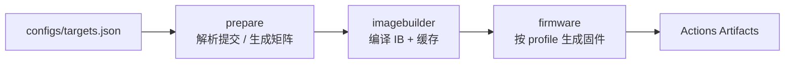

# LEDE ImageBuilder Action

用 [coolsnowwolf/lede](https://github.com/coolsnowwolf/lede) 源码构建 **ImageBuilder**，再用它按需生成固件。

lede 不发布官方 ImageBuilder（[releases](https://github.com/coolsnowwolf/lede/releases) 里只有少量整机固件），所以工作流分两阶段：先编译 ImageBuilder，再反复复用它出固件。第一阶段按上游提交 + 配置做缓存，只有 lede 更新或 `configs/targets.json` 变化时才重新编译。



## 文件结构

| 路径 | 作用 |
| --- | --- |
| `.github/workflows/imagebuilder.yml` | 全部工作流：解析 → 编译 ImageBuilder → 生成固件 |
| `configs/targets.json` | 要构建哪些设备、profile、附加软件包 |

## 快速开始

1. 把本目录推送到自己的 GitHub 仓库。
2. 按需修改 `configs/targets.json`（见下节）。
3. 打开仓库 **Actions → lede-imagebuilder → Run workflow**。
4. 构建完成后在该次运行页面底部下载：
   - `ib-<target>-<subtarget>`：ImageBuilder 本体（保留 3 天，供复用/本地调试）
   - `firmware-<name>`：固件、`sha256sums`（保留 30 天）

触发方式：

| 触发 | 条件 |
| --- | --- |
| `workflow_dispatch` | 手动，可选 `lede_repo`、`lede_ref` |
| `schedule` | 每周一 02:00 (UTC+8) 跟随上游重建 |
| `push` | 修改 `configs/targets.json` 或本工作流时 |

## 配置 targets.json

```json
{
  "targets": [
    {
      "name": "x86-64-generic",
      "target": "x86",
      "subtarget": "64",
      "profile": "generic",
      "packages": ["luci-app-ttyd", "openssh-sftp-server"],
      "rootfs_partsize": "2048"
    }
  ]
}
```

| 字段 | 必填 | 说明 |
| --- | --- | --- |
| `name` | 是 | 任务/产物名，唯一，避免空格和 `/` |
| `target` | 是 | 如 `x86`、`ramips`、`rockchip`、`mediatek` |
| `subtarget` | 是 | 如 `64`、`mt7621`、`filogic`；只有一个子目标的 target 也写其目录名（如 `generic`） |
| `profile` | 是 | ImageBuilder 设备名（小写），**必须属于该 target/subtarget** |
| `packages` | 否 | 额外软件包；`-pkg` 表示从默认集合中移除 |
| `files` | 否 | 覆盖文件目录（相对仓库根目录），内容合并进 rootfs |
| `rootfs_partsize` | 否 | rootfs 分区大小（MB），仅对可扩展分区的设备有效 |
| `disabled_services` | 否 | 生成镜像时禁用的 init 服务数组 |

工作流会：

- 按 `target`+`subtarget` 去重编译 ImageBuilder；
- 把该 target 下所有 `packages` 的**并集**写进 ImageBuilder 的构建配置，保证每个固件要用的 ipk 都在本地仓库里；
- 每条配置单独生成固件，互不影响。

### 如何确定 target / subtarget / profile

- 浏览 `target/linux/<target>/<subtarget>/target.mk` 与 `target/linux/<target>/image/*.mk`；`define Device/<name>` 里的 `<name>` 就是 `profile`。
- 或下载工作流产出的 ImageBuilder，解压后执行 `make info`，列出全部 profile 与默认包。

例如 ramips/mt7621 上小米 4A 千兆：

```json
{
  "name": "xiaomi-4a-gigabit",
  "target": "ramips",
  "subtarget": "mt7621",
  "profile": "xiaomi_mi-router-4a-gigabit",
  "packages": ["luci-app-ttyd"]
}
```

> `profile` 写错会在固件阶段直接报 `Profile "xxx" does not exist!`；先跑一次或查源码确认，避免浪费时间。

## 覆盖文件（FILES）

需要预置配置（LAN IP、时区、主机名、免密公钥等）时，放一个目录并使用 `files` 字段：

```
files/x86-64/
└── etc/
    └── uci-defaults/
        └── 99-custom
```

```sh
#!/bin/sh
uci set network.lan.ipaddr='192.168.10.1'
uci commit network
exit 0
```

然后在配置里加 `"files": "files/x86-64"`。ImageBuilder 会把该目录合并进 rootfs，`uci-defaults` 脚本在首次启动时执行。

## 缓存与强制重建

ImageBuilder 缓存键：

```
ib-<CACHE_VERSION>-<lede 提交 SHA>-<target>-<subtarget>-<targets.json 哈希>
```

- lede 有新提交、或 `targets.json` 改动 → 自动重建；
- 想在不改配置的情况下强制重建：把工作流顶部的 `CACHE_VERSION`（默认 `v1`）改成 `v2`；
- 缓存中缺少/损坏的 tar 会被检测出来并重新编译。

## 构建细节

ImageBuilder 阶段的 `.config` 由工作流生成：

```
CONFIG_TARGET_<target>=y
CONFIG_TARGET_<target>_<subtarget>=y
CONFIG_TARGET_MULTI_PROFILE=y            # 同一 target 下选中多个设备
CONFIG_TARGET_PER_DEVICE_ROOTFS=y
CONFIG_TARGET_DEVICE_<target>_<subtarget>_DEVICE_<profile>=y
CONFIG_IB=y
CONFIG_IB_STANDALONE=y                   # 所有已编译 ipk 打包进本地仓库
CONFIG_PACKAGE_<pkg>=y                   # packages 并集
```

之后执行 `make -j$(nproc)`（失败时回退 `-j1 V=s` 看真实错误），产物为 `bin/targets/**/*imagebuilder*.tar.xz`。

固件阶段等价于在 ImageBuilder 目录中执行：

```sh
make -C <imagebuilder-dir> image \
  PROFILE="<profile>" \
  PACKAGES="<packages>" \
  BIN_DIR="$PWD/out/<name>"
```

## 本地复现

从 Actions 下载 `ib-<target>-<subtarget>` 后：

```sh
tar -xJf x86-64.tar.xz -C ib-root
cd ib-root/openwrt-imagebuilder-*/
make info
make image \
  PROFILE=generic \
  PACKAGES="luci-app-ttyd openssh-sftp-server" \
  BIN_DIR="$PWD/out" \
  FILES="$OLDPWD/files/x86-64"
```

## 注意事项

- **不是官方 OpenWrt ImageBuilder**：包集合、内核与官方 `downloads.openwrt.org` 不通用，不要混用 opkg 源。
- 首次构建（含工具链、feeds、内核包）在 4 核 runner 上通常 40–90 分钟；命中缓存后固件阶段通常 5–15 分钟。
- 磁盘：编译阶段需要 25 GB 以上，工作流已调用 `free-disk-space` 并清理预装 SDK。runner 空间不足时优先减少 `packages`。
- 镜像体积受设备 flash 限制，`rootfs_partsize` 只对支持扩容分区的设备生效。
- 固件为本地构建，未签名；刷机前核对 `sha256sums`，并保留原厂固件以便回退。
- 需要 `LEDE` 上游之外的分支/标签时，用 `workflow_dispatch` 的 `lede_ref` 参数（如 `20251001`），缓存按该提交区分。
